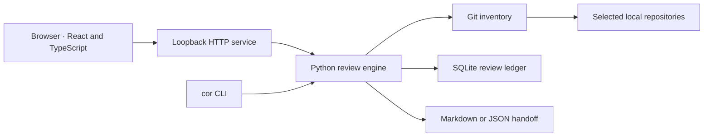

# Architecture

Own the Diff has one local review engine and two clients. Git determines what changed. The engine groups that evidence into decisions, records the human review, and verifies whether the feature is ready for handoff. Both clients receive the same result.

## A capture freezes the comparison

A project configuration specifies the objective, acceptance criteria, repository aliases, base and target for each repository, and any declared producer–consumer relationships. A target can be a Git ref or the final state on disk. `cor init` and the browser's **New review** perform the first capture.

[Git inventory](cor/inventory.py) reads each selected checkout, records its base and target identity, and reconciles the manifest against the canonical patch. Every changed file has a repository-qualified identity. Its hunks and metadata changes become individually identifiable pieces of evidence called **atoms**. Renames, file modes, binary files, and submodule pointers have explicit inventory entries. Text diffs are frozen. Binary or otherwise opaque content is represented by identities and metadata. Capturing does not run project scripts.

A **unit** is the smallest decision a reviewer can act on. A declared interface unit can contain atoms from both a producer and a consumer. One producer can appear in several units. Other changed files stay available through standalone units. [Analysis](cor/analysis.py) builds the units, detects supported evidence patterns, and suggests unambiguous HTTP connections. The reviewer confirms which suggestions enter the scope.

## A decision belongs to the evidence someone saw

[Engine](cor/engine.py) keeps four SQLite tables for sessions, captures, events, and idempotent actions. A review has a stable session ID, a current capture ID, and a monotonically increasing version. The private workspace defaults to `~/.local/share/code-ownership-review`. Both clients honor `COR_HOME`.

A write includes the unit, action, capture, version and action ID. A stale version produces a conflict. Repeating an identical action ID allows a client to retry a write. Dismissing a finding also requires its ID and a reason. Approving a unit and disposing of a blocking finding are separate recorded actions.

A refresh reads all participating repositories before updating the review. It compares the new evidence, contract and base context with the prior capture, retains eligible decisions, and explains stale decisions. Historical captures remain available for inspection. A failed capture leaves the previous review available.

## How the clients connect

The [CLI](cor/cli.py) calls the Python engine in process. It can create, inspect, decide, refresh, check, verify, and export with the web service stopped. The [browser](web/src/) uses a bundled React application served by the [HTTP adapter](cor/server.py). Node is needed only for frontend development. The macOS launcher opens the same local browser application.

The browser polls the session revision. When a revision changes it fetches the current state. An open confirmation stays bound to its original capture and version. Historical routes are read-only. The service checks the destination host, browser origin, and per-server session cookie. Mutations also require JSON and the application's request header.

| Operation | Local HTTP route |
| --- | --- |
| List or create reviews | `GET` or `POST /api/sessions` |
| Get a review or historical capture | `GET /api/sessions/{id}` with optional `?capture=...` |
| Inspect updates and decisions | `GET /api/sessions/{id}/revision` or `/history` |
| Record a human decision | `POST /api/sessions/{id}/decisions` |
| Refresh or revise scope | `POST /api/sessions/{id}/refresh` or `/config` |
| Verify and export | `GET /api/sessions/{id}/verify` or `/export?format=markdown` |

Browser links use `/#review/{session}/overview` and `/#review/{session}/decisions/{unit}`. A terminal user can open the same decision with `cor web --session SESSION_ID --unit UNIT_ID`. Use the [CLI reference](docs/cli.md) for automation.

## Checks and analysis attach evidence

The [trusted check runner](cor/checks.py) verifies the selected target identities and materializes the repositories into a disposable directory. It runs the user-selected command there and records the arguments, output, exit status, and capture. The process has the user's OS permissions. Check materialization requires trees without symlinks or submodule entries.

The [analysis adapter](cor/assistance.py) prepares bounded evidence packets for a local Ollama model or an independent reviewer. Imported findings must reference evidence belonging to their unit. The ledger records assessed and unknown changes for each independent pass. Model output can add findings. Human decision events determine approval.

## What verification proves

Verification checks that captured atoms are represented, every decision is approved, blocking findings are resolved, and configured checks and analysis passes have current evidence. It recaptures live Git inputs and compares their identities with the frozen targets. It also checks that the review version stayed stable during verification. The result includes the capture, version, coverage counts, readiness, and blocker reasons.

Markdown and JSON exports include the verification state. JSON also includes the portable review ledger. Redaction strips configured checkout roots, full blob contents, and recognized sensitive patches or lines. See [data handling](SECURITY.md) for the limits.

## Exercise the boundaries

Use the [two-repository walkthrough](docs/review-guide.md) to record a fix request in one client, inspect it in the other, edit the consumer, refresh, and compare history. The [test suites](CONTRIBUTING.md#development-setup) cover Git edge cases, multi-repository grouping, stale writes, carry-forward, and the shared review lifecycle.
