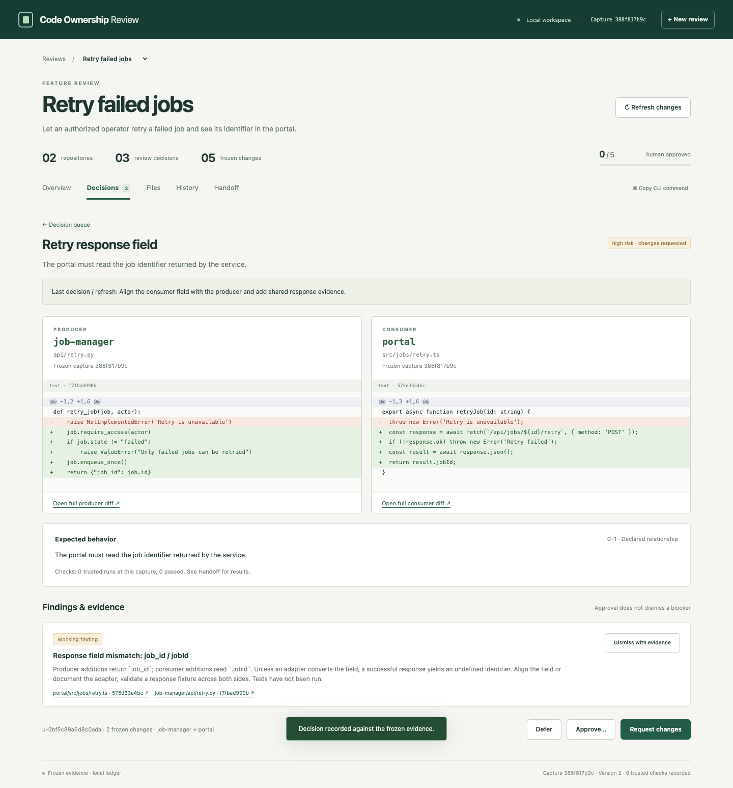

# Own the Diff

Review AI-generated code across Git repositories in one local workspace. Follow a feature from the service that implements it to the app that uses it, question changes that seem unnecessary, and keep a record of what you personally checked.

[Try the demo](#try-the-demo) · [Review your own feature](#review-your-own-feature) · [CLI reference](docs/cli.md) · [Roadmap](roadmap.md) · [](https://github.com/sethigoldy/own-the-diff/actions/workflows/ci.yml)

## Why I built this

I spent several months building a feature that grew to more than 45,000 lines of code. I was using AI to write code across multiple repositories. I could follow an individual change while it was in front of me. What I struggled with was keeping a mental model of the whole feature as the changes kept coming.

I read the plans carefully, but I still found code I hadn't asked for and things implemented differently from what I'd intended. When I asked the AI to walk me through what it had written, the summary skimmed over the details I needed to understand. Before handing the feature to a colleague, I wanted to be able to point at a change and explain, in my own words, why we needed it.

That's why I built Own the Diff. I wanted to start with what actually changed in Git, follow one behavior across repositories, and come back the next day knowing what I'd reviewed and what still needed a decision.

## Who it's for

- **Engineers using coding agents** who want to check whether the implementation follows the plan, reuses what already exists, and does what they asked for.
- **Reviewers and tech leads** who need to follow one feature through several pull requests. You can put an API change beside its caller and give the author a specific reason to revise either side.
- **Maintainers picking up a review after another round of edits.** You can see which approvals still apply and reopen the decisions affected by the new code.

## Try the demo

An operator retries a failed job. The Python service returns `{"job_id": job.id}`, and its unit test passes. In another repository, the TypeScript portal reads `result.jobId`. The retry succeeds, but the portal gets `undefined` where it expects the job identifier.

With Git and Python 3.9 or later installed, run these commands. The web UI is bundled and the demo runs locally without an account, model, or Node installation.

```sh
git clone https://github.com/sethigoldy/own-the-diff.git
cd own-the-diff
python3 -m cor web
```

1. Select **Explore the working demo**. In **Overview**, find **Retry response field** and choose **Inspect both sides**. The lines that return and read the identifier are now on the same screen.
2. Choose **Request changes** and explain which field the portal should read. Open **History** to see that decision, or run `python3 -m cor history --session "Retry failed jobs"` in another terminal from the checkout.
3. In **Decisions**, open `retry/store.py`. The plan calls for reusing the existing persistence code, yet the patch creates a new database client. Could the retry feature use the client the service already has?



**Prefer the terminal?** From the same checkout, run the following commands. The first creates or reopens the demo and prints the two example directories. The second walks you through the review. Both clients share the same decisions.

```sh
python3 -m cor demo
python3 -m cor review --session "Retry failed jobs"
```

To try a second review pass, change `result.jobId` to `result.job_id` in the demo portal, save, and select **Refresh changes**. You can compare the corrected change with your earlier request in **History**. [Full demo walkthrough](docs/review-guide.md#walk-through-the-demo)

## Review your own feature

1. **Write down the intent.** Choose **New review** and describe what the feature should do. Include constraints you care about, such as “reuse the existing job queue.” Add the local Git checkouts and choose what to compare in each.
2. **Follow the behavior across repositories.** Connect the file that produces a value to the file that consumes it. If an API has two callers, add a connection for each. Open the paired diffs in **Overview**. Changes outside those connections still appear in **Decisions** and **Files**.
3. **Decide what belongs.** Inspect the code against your criteria. Approve what you understand, request a change with a reason, or defer an open question. Each decision is tied to the version of the code you read. An independent reviewer can examine a packet of Git evidence and contribute findings. You make the approval decision.
4. **Pick up where you left off.** After the next edit, refresh and see which decisions need another look. When you're ready to hand off, **Handoff** checks the review against live Git and lists anything still open. Export a Markdown summary for your pull request or a JSON record for later.

For a terminal-only review, start with the [example project file](examples/review.json) and the [CLI walkthrough](docs/cli.md#start-a-review). Run `uv tool install .` or `pipx install .` to make `cor` available outside the checkout. On macOS, you can also open **Code Ownership Review.app** from the checkout. Keep the launcher beside the source.

## Documentation

| What you want to do | Where to go |
| --- | --- |
| Choose Git comparisons, review multiple consumers, or understand a blocked handoff | [Review guide](docs/review-guide.md) |
| Run trusted checks, use a local Ollama model, or import findings | [CLI reference](docs/cli.md) |
| Give a coding agent a focused review task | [Scope review](skills/scope-review/SKILL.md), [minimalism review](skills/minimal-review/SKILL.md), and [guided review](skills/guided-review/SKILL.md) |
| Understand what is stored locally and what an export contains | [Data handling and security](SECURITY.md) |
| Understand how the product works or contribute a change | [Architecture](ARCHITECTURE.md) and [contributor guide](CONTRIBUTING.md) |
| Read the product design and pilot criteria | [Product specification](product-spec.md) |

## License

Own the Diff is licensed under [Apache 2.0](LICENSE). The bundled browser dependencies have their own [license notices](THIRD_PARTY_NOTICES.txt).
