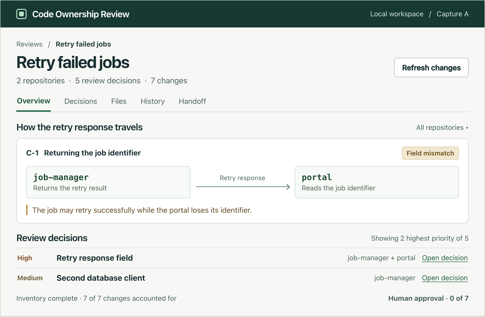
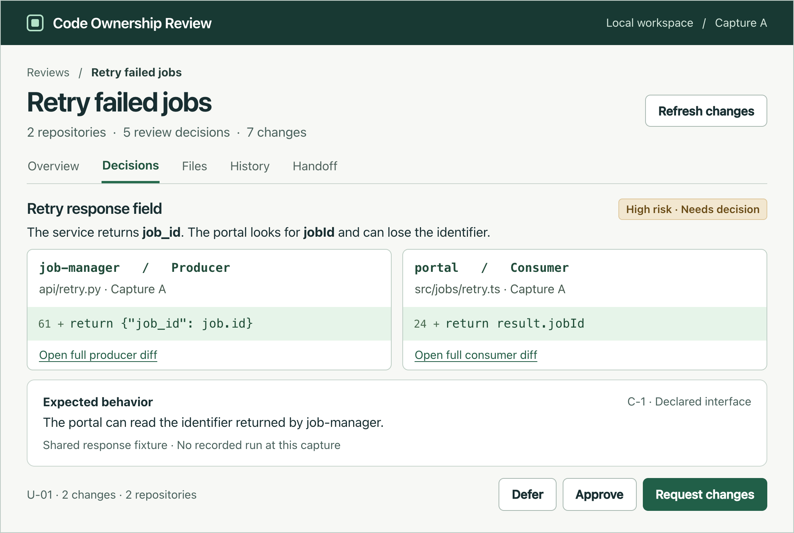

# Code Ownership Review

**Product specification · Revision 0.2 · Draft for review · 17 November 2026**

A retry succeeds in the job service. The portal still loses the job identifier. Reviewing either repository by itself makes the mistake easy to miss. Code Ownership Review brings the two sides of that behavior into one decision, with the exact lines, the intended contract and the test evidence available at that moment.

### Two ways to complete the same review

**The web app** is for following a feature across services. Open a feature, see which repositories produce and consume the changed behavior, then inspect both ends of a connection side by side. Every step from adding repositories to exporting a PR summary is available in the browser after launching the local app.

**The CLI** is for engineers working in a terminal, scripts and coding agents. It can capture, analyze, guide a human through decisions, refresh, verify and export. A reviewer can start in either interface, switch in the middle and keep the same decisions and evidence. Both interfaces ship in the first release.

### Decisions for this review

| Design choice | Proposed default | What to test |
| --- | --- | --- |
| Navigation | Start with a feature and the behaviors that changed. Keep a complete file inventory one click away. | Can a new reviewer explain how one change affects a second repository? |
| Sign-off | Approve a named decision and its exact changes. Show open findings and the impact of later edits. | Can someone tell which work another capture reopened and why? |
| Deployment | One local workspace serves the browser and CLI. Source stays on the device by default. | Can a reviewer complete the whole journey in their preferred interface? |

**Reading guide.** Sections 5–8 show the same review in the web app and CLI. Sections 9–11 define the shared approval, handoff and storage rules. Sections 12–14 cover acceptance and the pilot. This revision builds on the original Code Ownership Review proposal, version 0.1.

## 1  The release and its users

### When someone reaches for the product

A backend engineer has agreed to add manual retries for failed jobs. The agent changes the portal, the job manager and their tests. The engineer can already read a diff. What takes time is reconstructing why each piece exists, finding the older implementation it might duplicate and remembering what they approved before the agent made its last edit.

| Moment | What the engineer needs to do | What the product returns |
| --- | --- | --- |
| Before or after the agent works | State the behavior, constraints and repositories in scope. | A dated contract the engineer can approve, including any intent supplied after implementation. |
| Before the first review | See the complete size and shape of the change. | An offline inventory for the chosen base and target in each repository. |
| While reviewing | Inspect the decisions most likely to affect behavior. | A queue with the actual diff, linked requirements, alternative code and test evidence. |
| After asking for a fix | Return to the decision that changed. | A new capture, a reason for each stale approval and the remaining work. |
| At PR handoff | Explain what was checked and where uncertainty remains. | A concise Markdown summary and a complete, versioned JSON ledger. |

### Scope of the first release

Support one engineer reviewing one or more local Git working trees, with semantic context for Python, JavaScript and TypeScript. Other languages, binaries and generated files still appear in the inventory. The review works offline with manual decisions. Configured analysis adds independent scope and minimalism passes, plus bounded checks against repository conventions and declared interfaces.

The web workspace includes review setup, a feature overview, a relationship map, a searchable decision queue, a full diff browser, review history and handoff. The local CLI includes the corresponding review operations and a guided terminal view. Coding agents can use scope, minimalism and guided-review skills against the same engine. Hosted collaboration, PR posting and automatic fixes are later product decisions.

## 2  Starting a review

### A small contract with an identifiable owner

The contract contains a feature ID, objective, acceptance criteria with stable IDs, expected repositories and paths, non-goals, engineering constraints, cross-repository interfaces and decisions that require escalation. The engineer approves a version before analysis uses it as the baseline. Changes to the contract get a new version, author, time and rationale. A change outside an expected path gets flagged. The engineer can propose a plan amendment when that change is necessary.

For an existing diff, capture immediately. Let the engineer supply the original ticket or reconstruct the intent, label its origin and approve it locally. Until then, show inventory and mark scope analysis “awaiting approved intent.” Keep the distinction between an original commitment and a later explanation in the export.

### First session in either interface

| Task | In the browser | At the terminal |
| --- | --- | --- |
| Open a workspace | Launch the installed app and choose New review. The local browser window opens without a terminal or account. Existing sessions offer Resume. | Use `cor init` to set up a workspace, or `cor web` to open its browser view. |
| Choose scope | Add local folders through the launcher’s folder chooser. Set a repository alias, base ref, target and untracked rules. Confirm the preview for every repository. | Set the same fields in project configuration. Approve the proposed intent interactively. |
| Capture | Select Capture changes. See each repository’s progress and the resulting capture ID. | `cor capture --contract review/intent.yaml` returns the same identifiers and counts. |
| Inspect and analyze | Open Files to browse every change. Select Analyze, choose passes and budget, then open Decisions. | `cor inventory --all-repos`, `cor analyze` and `cor review` cover the same sequence. |

### First run and recovery

Both interfaces identify the repository and corrective action for a missing checkout, inaccessible base or unresolved merge. Reconnect lets the user choose the intended folder. An incomplete capture leaves the last complete one available as history. An empty result shows the base and target and “Nothing to review.” Editing the scope creates a new capture.

## 3  Freezing the change set

### A reviewable target for each repository

Pin the base to a commit SHA. A committed target names a second SHA. For a working target, start from the index, overlay the on-disk state of its tracked paths and add explicitly included untracked paths. Absent tracked paths become deletions. If a file was staged and then edited again, capture the difference between the base and its final on-disk contents once. The staged intermediate version remains available in Git. Show that choice before capture.

Build the target using private temporary state, then compare the frozen target with the base. Leave the user’s index, refs and working files untouched. Record target tree identity, blob IDs, path inclusion rules, Git diff settings and repository alias. Check for edits during capture and retry or mark the attempt incomplete. Publish the multi-repository capture only when all configured targets have been captured and validated. Record each target’s capture time and surface drift at verify, because independently edited repositories can change between reads.

### The smallest item that counts

| Git change | Ledger representation |
| --- | --- |
| Text addition, edit or deletion | One atom per canonical diff hunk with old/new path, range, side and patch hash. The file record lists all its atoms. |
| Rename, copy or mode change | Explicit metadata atom for a detected transition, plus any text hunks. With ambiguous rename or copy detection, preserve the underlying add/delete or add records Git actually reports. |
| Binary, empty file, symlink or submodule | Record the applicable opaque or metadata transition, before/after identity and available evidence. A changed submodule pointer identifies the commits. Reviewing nested contents requires a configured repository. |
| Generated, vendored, whitespace or lockfile change | Keep every atom. Add a grouping label and its basis so that the engineer can inspect the group together. |

Enumeration uses fixed diff options and machine-readable paths. Reconcile against an independently obtained Git manifest and canonical patch, including non-text transitions. Each atom must have a review unit or its own record. Two units can reference the same atom. Coverage counts distinct atom IDs. Truncating a displayed diff exposes a way to open the full frozen content. Loss during capture or reconciliation blocks readiness.

## 4  What the reviewer must show

Every pass receives the approved contract, frozen inventory IDs and bounded source context in a fresh review session. Repository text and the authoring agent’s summary are material to inspect. Neither can change the instructions, grant permissions or establish coverage. Sequential passes suffice for the first release.

| Pass | Question | Minimum evidence |
| --- | --- | --- |
| Scope | Which agreed behavior needs these lines? | Atom IDs, a criterion or constraint, cited lines and a rationale. Use required, supporting, mechanical, plan gap, unrequested, deviation or unknown. |
| Minimalism | What would break if we left this addition out? | New symbol, existing alternative, callers examined, behavior to preserve, uncertainty and a concrete validation step. |
| Conventions | Which local practice applies here? | A versioned repository rule or a comparable implementation. A personal preference can be recorded as a suggestion. |
| Correctness and contracts | What observable failure matters to this feature? | Both sides of a declared interface, a behavior or failure case, and any associated test result. Missing evidence stays visible. |

### A finding an engineer can act on

For a new `RetryStore`, cite its constructor and the existing DAL client at frozen paths and lines. Show which callers use the new wrapper. Explain whether the shared client preserves transaction scope and credential handling. If those properties are uncertain, propose a check before recommending removal. A source search that finds a similar class name alone cannot establish equivalence.

### Accounting for uncertain answers

Store finding ID, pass, affected atoms, snapshot-qualified evidence, severity, confidence or “unassessed,” proposed action and validation. Validate identifiers, paths and ranges against the capture. Reject invented references. Missing results remain pending and can be retried without duplicating earlier results. Preserve disagreement between passes. A scope pass can find that persistence is required while a minimalism pass questions a second client. For large diffs, page the inventory and cap context per unit. Budget exhaustion saves progress and lists the remaining IDs. Show the configured spending limit before a remote run. Record actual cost when the provider reports it.

## 5  A review across two repositories

### Worked example with illustrative code and counts

The engineer approves four criteria for retrying a job. **AC-1** limits retries to failed jobs. **AC-2** preserves resource-level authorization. **AC-3** reuses the existing execution path. **AC-4** prevents two simultaneous requests from creating duplicate work. **C-1** names the response contract between the TypeScript portal and Python job manager. A separate database client is an explicit non-goal.

| Frozen evidence at capture A | What the engineer sees |
| --- | --- |
| `job-manager/api/retry.py:61` returns `{"job_id": job.id}`. | The producer returns the identifier under the snake-case field. |
| `portal/src/jobs/retry.ts:24` reads `result.jobId`. | The consumer reads a different field. Isolated tests using separate fixtures could pass on both sides. |
| `job-manager/retry/store.py:8` constructs a client. `job-manager/dal/jobs.py:19` exposes the existing client. | A reuse candidate links the two locations and asks whether they share transaction and authorization behavior. |

### From evidence to decisions

The queue puts **C-1** first because a successful retry could leave the portal without the job identifier. The engineer opens both sides, requests a consumer fix and asks for a response fixture exercised by both sides. They also request removal of the duplicate client after checking its callers. They approve the resource-authorization unit against AC-2.

The agent edits the consumer, removes the new client and updates the fixture outside review mode. Capture B links the changes to the requests. The removed client leaves the current denominator and stays visible in history. The updated response and its dependent unit return to review. The unchanged authorization approval carries forward only if its recorded context still matches.

### What counts as checking an interface

Start with engineer-declared producer, consumer and contract ID. Show field names, types, optionality, error behavior, version compatibility and evidence from each side as applicable. Suggested edges carry an “inferred” label. A missing checkout or unknown deployment order leaves the connection unverified. Resolving a required interface needs cited evidence and a human disposition. A matching name alone never clears it.

## 6  The web workspace

Start at Reviews to create a session or resume a feature. Inside a session, **Overview** answers three questions in order. What behavior changed? Which repositories participate? Which decision needs me first? The header names the feature and capture. Repository counts and human approval remain visible as the engineer narrows the view.



### Following a change through several repositories

Select a behavior to see a directed path. Label each connection with what travels, such as “retry request” or “retry response.” Select the connection to open its decision. The return path can point in the opposite direction to the request. Labels distinguish a declared contract from an inferred relationship. A missing consumer stays visible as “Repository unavailable,” with the evidence needed to resolve it.

For a shared library with several consumers, show the producer, shared type and affected consumers in order. Collapse additional consumers behind a count and allow expansion. Cycles link back to the earlier step. With many repositories, start with the selected behavior and list other affected behaviors below. A repository filter retains the opposite endpoint as context and shows both filtered and global counts. Every path also has an ordered text view with the same links.

## 7  The web decision view

**Decisions** lists behavior-level questions ranked by risk. Search by requirement, repository, symbol or file. Open a row to see a plain-language consequence, the relevant code in each repository and the decision that would resolve it. The paired panes below show two repositories at the same capture. Each pane has its own before-and-after diff.



### Inspect and decide

Both evidence panes identify repository, path, line, role and capture. Open full diff expands old and new content with surrounding context. **Files** reaches every included hunk, metadata change and binary, even when automated analysis cannot place it in a behavior. Browser Back restores the decision, filter and scroll position. At narrow widths, stack the labeled panes in producer-to-consumer order. A keyboard user can reach evidence and actions in that same sequence.

**Approve** previews the exact changes before confirmation. **Request changes** records the fix and affected repositories. **Defer** saves the open question. None of these actions implicitly resolves a separate blocker. **History** explains what a refresh reopened. **Handoff** shows blockers, the evidence required to clear them and the two export options. A browser reload restores the saved state. Evidence links carry a capture ID. Older links open that historical version with a link to the current capture.

## 8  The guided terminal review

### Complete a review from the shell

The guided CLI works without launching the web app. The default queue puts cross-repository mismatches, authorization, data writes, concurrency and public behavior ahead of ordinary edits. Each unit displays the reason for its rank. Ties use stable repository, path and atom order so the queue stays predictable on resume. Filtering changes the view. The overall coverage totals stay in sight.

```text
cor review    retry-failed-job    capture A          unit 1 of 5
All changes   7/7 inventoried     0/7 human-approved

Retry response field                        HIGH   Needs decision
C-1  The portal must read the identifier returned by job-manager.
2 repos  /  2 hunks                          Tests: not run

job-manager/api/retry.py  @ A                 producer  +61
+ return {"job_id": job.id}

portal/src/jobs/retry.ts  @ A                 consumer  +24
+ return result.jobId

Finding   The consumer reads a different field.   Decision U-01
Evidence  [1] Response builder  [2] Portal caller  [3] Contract

[a] Approve   [r] Request changes   [d] Defer   [i] Investigate
[f] Full diff   [e] Evidence   [q] Save and exit
```

### Interaction details

The engineer can expand surrounding lines, inspect the previous version, jump to another unit and return to the same position. Evidence opens at the frozen revision. For a deletion the old side opens first. A binary opens a metadata view with hashes and review limitations. An ordinary terminal, narrow window or colorless session must still show the change, side, risk and status as text. A plain linear view supports terminals that cannot render the interactive layout.

Approve previews the exact atoms and requires an explicit confirmation. Request changes records the intended fix. Defer records the outstanding question. Investigate opens evidence and returns to the same unit. Viewing, quitting and model output cannot create approval. A blocking finding stays open until the engineer records a fix verified in a new capture or dismisses it with evidence. Only an explicit human action in the terminal or browser records sign-off. To continue visually, open the same unit with `cor web --session retry-failed-job --unit U-01`. The browser’s “Open in CLI” control copies `cor review --session retry-failed-job --unit U-01`.

## 9  Decisions after the next edit

### Record actions against what the engineer saw

Each human event records the local reviewer identity, action, target atoms, capture, contract and policy hashes, evidence dependencies, timestamp and rationale where required. Inventory, analysis completion and viewing are independent facts. The current decision can be pending, approved, changes requested, deferred or stale. The local identity is a self-declared reviewer label. It provides continuity for the engineer and carries no organization attestation.

### Refresh and explain every change in approval

| On the next capture | Default behavior |
| --- | --- |
| Same patch and blobs, unique correspondence, same scoped inputs | Carry the explicit decision with a link to its original event. Preserve its original reviewer and time. |
| Content, cited blob or declared interface changes | Mark affected approvals stale, including dependent units in another repository. Show which path, input or contract changed. |
| Base moves, rename is ambiguous or dependency evidence is incomplete | Reopen approvals in the affected repository or dependency scope. Where the scope is uncertain, reopen the whole capture. |
| Engineer approves revised intent or review policy | Keep the prior version and reopen all affected decisions. For the pilot, a contract or policy hash change reopens the full review. |
| Atom disappears or first appears | Archive the removed atom and its decisions. Create a pending decision for each new atom. Never transfer by line number alone. |

Choose Refresh changes in the browser, then open History. The CLI equivalents are `cor capture --refresh` and `cor status --stale`. Both show what reopened, what carried forward and which capture each decision belongs to. For the pilot, changing any function in a reviewed file reopens approvals that used that file. An edit in a separate file can preserve approval when the full recorded dependency set is unchanged. A resumed UI that detects a newer capture asks the reviewer to refresh before it commits a decision. History remains append-only.

**Acceptance example.** Two units share a response field. An engineer approves both, then the producer changes the field type. Refresh shows both decisions as stale with the producer as the cause. A separately approved authorization unit with unchanged files and known dependencies stays current. Reopening the tool restores the same three results.

## 10  Verification and PR handoff

### Four counts an engineer can audit

| Measure | Numerator and denominator |
| --- | --- |
| Inventory | Unique represented atoms / atoms in the independent Git inventory. Report per repository and overall. A failed capture has no valid total. |
| Analysis | Atoms with an assessed or explicitly unassessable outcome for every selected pass / inventoried atoms. Break out unassessable, pending and skipped passes. |
| Classification | Atoms with a recorded scope class / inventoried atoms. Show unknown separately and let a human record an evidenced resolution. |
| Human approval | Distinct required atoms with current explicit approval / distinct atoms requiring approval. The proposed default requires all included atoms. |

An empty denominator displays “not applicable” with its reason. Skipping all automated passes displays “not run.” A unit that shares atoms with another unit cannot clear that unit’s outstanding request, deferral or blocker. Test evidence has a separate status and provenance.

### The default readiness gate

Select Verify in Handoff or run `cor verify`. Both compare current inputs with the capture, reconcile inventory and list each blocker with its next action. Readiness requires approved intent, current human approvals, resolved scope gaps and a disposition for every blocking finding. High-risk findings block by default. Every policy-required interface check and test needs current, passing evidence. A human can resolve a false positive with evidence and a reason. A valid plan gap needs an approved contract amendment or a revised implementation. In manual mode, a human supplies mappings and resolves unknowns with cited evidence. Unresolved unknowns stay pending. Any unfinished pass selected as mandatory by policy remains a blocker.

### Example after the fix

```text
Capture B  |  2 repositories  |  5 files  |  6 text hunks
Inventory 6/6   Analysis 6/6   Classified 6/6   Approved 6/6
C-1 checked on both sides [E12, E13]. Open blockers: 0
RetryStore removed since A [A4]. Shared fixture passed [T2 @ B].
Ready for PR review under the recorded policy.
```

Handoff and `cor export` offer a Markdown PR summary and a versioned JSON ledger of changes, findings, decisions, exclusions and evidence. E12 and E13 open the two cited lines, A4 the removed code and T2 the test result. Export rechecks live inputs and labels incomplete reviews. Each repository’s PR summary identifies its external dependencies and the overall feature status.

## 11  Local architecture and trust

### How data moves through the product

The proposed implementation uses a React/TypeScript web app served locally, a Python CLI and one Python review engine. The launcher opens the browser and manages the local service. The CLI can use the engine with the browser closed. A workspace ID selects the same private store on both sides. Git supplies frozen targets and the canonical diff. Local search and Tree-sitter add symbol context. A failed parse leaves the raw diff available.

| Record family | Data that must survive restart |
| --- | --- |
| Session and capture | Feature ID, versioned intent, repository aliases, base and target IDs, exclusion rules, diff options, policy and capture completeness. |
| Changes and evidence | File transitions, atom IDs, patch hashes and old/new ranges, unit memberships, mappings, declared dependency edges and frozen evidence references. |
| Outcomes | Pass attempts and budget, findings and dispositions, append-only human events, check command and result at a target, verifier result and blocker reasons. |

SQLite is authoritative for both clients. Store immutable patches and blobs outside the working trees. Decision writes carry the expected capture, event version and a unique action ID. Reject a stale write, return current state, and apply a retried action once. The browser subscribes to capture and review events and reloads the latest version on reconnect. The CLI reads the ledger at command start and rechecks before saving an interactive action. A disconnected browser can display its last loaded view with a timestamp and disables sign-off until it reconnects.

### Boundaries the engineer controls

Serve bundled assets on loopback. The launcher establishes a short-lived local session, checks the requesting origin on writes and limits file reads to approved roots and captured blobs. Browser URLs reference IDs. Default to offline inventory and read-only source access. A remote provider requires opt-in showing the destination and eligible paths. Exclude configured sensitive files and redact detected secrets before sending a bounded context. Store credentials in the OS credential store. Turning off source transfer still permits a local provider or manual review. The engineer can inspect and delete locally retained snapshots, patches and logs.

Repository contents, including comments and project-supplied commands, are untrusted inputs. Select Run check from evidence or use `cor check` to run an explicitly trusted command against the recorded target in an isolated workspace. Record command, target, exit code and log reference. Outside evidence needs its provenance. A result from a different target is stale. PR summaries omit raw patches, secrets and machine-specific paths by default. A detailed export identifies any redacted fields while retaining their atom records.

## 12  Release acceptance

Each check below has an observable failure condition. Exercise the shared engine through both clients, including a restart between capture and sign-off. The retry example supplies a cross-repository fixture that ties the checks together.

| ID | Exercise | Required observation |
| --- | --- | --- |
| R1 | Capture mixed staged and unstaged edits, included and excluded untracked paths, a rename, deletion, copy, mode change, empty file, binary, symlink and submodule. Include a Unicode path with spaces. | Independent Git inventory agrees by identity and count. The real index and working files stay intact. Every opaque transition is inspectable. |
| R2 | Drop an atom during grouping, duplicate a membership, fail a parser, interrupt capture of the second repository. | Missing atom blocks verification. Shared atom counts once. Parser failure leaves a raw record. Partial capture cannot replace the last complete one. |
| R3 | Supply a fabricated evidence path, a pass that omits an ID and a removal suggestion based only on a similar name. | Invalid references are rejected. Missing work remains pending. Unsupported removal stays a question. Conflicting valid findings remain visible. |
| R4 | View, defer, request a change and approve in separate units. Restart the terminal. Attempt to approve its superseded capture. | Only the explicit current approval counts. Reasons and place in the queue survive. The out-of-date action is rejected. |
| R5 | Edit the producer after approving both sides, change an unrelated file, move the base, then make two possible matches for an old hunk. | Dependents reopen with reasons. Eligible unrelated approvals carry. Base drift and ambiguous matches require re-review. |
| R6 | Disable networking and all providers. Review a real diff manually. Export with a missing required test, then with its passing result recorded. | Manual review completes offline. The first summary lists the missing test and blocker. Only the current recorded execution can support the passing claim. |
| R7 | Stop analysis mid-batch, resume under the same budget, export an incomplete review and delete the local session. | Completed findings appear once. Pending work and spend remain visible. Export shows current limitations. Session deletion clears retained review content. |

**Usability check.** Ask a pilot reviewer to find the raw change, name its requirement, explain the alternative and resume after an edit without coaching. Record where they got stuck. The product can meet the inventory checks and still fail this test.

## 13  Browser and CLI acceptance

Passing requires a complete review in each interface and a successful handoff in both directions. For independent runs, compare repository content, change membership, blockers and test evidence on the same fixture. Within one shared session, both clients must display identical capture IDs, decisions, approval totals and export status.

| ID | Reviewer task | Release condition |
| --- | --- | --- |
| U1 | From a clean install, start a browser-only review of two repositories. Repeat from the CLI with the web service stopped. | Both paths cover setup, intent, capture, analysis, diff inspection, decisions, refresh, verification and export. Each works with remote analysis disabled. |
| U2 | Capture from the CLI, request a consumer fix in the browser, then refresh from the CLI. Open History in the browser. | Both show the same request, affected repositories, stale reason and surviving approvals. Selecting a decision in one client opens the identical unit in the other. |
| U3 | Approve from the CLI while an older browser tab is open. Attempt a conflicting browser write, disconnect, reconnect and retry. | Exactly one decision for the first action. A stale action explains the conflict. Reconnect restores current approval totals before another decision is accepted. |
| U4 | Follow a producer through a shared library to three consumers, one unavailable. Filter to one repository and open its counterpart. | All consumers are discoverable, missing evidence is explicit, and one shared hunk counts once. Filtered results cannot mark the whole feature ready. |
| U5 | Use keyboard navigation and a narrow window. Find the differing fields, open both diffs, return to the decision, defer and resume. | Focus and labels identify the two roles, status and next action. The ordered list supports the same journey as the diagram. The saved question survives reload. |
| U6 | Search a large capture, including a binary and an ungrouped text change. Open an old evidence link after recapture. | Results are paged, total counts stay exact, all items open and each historical link identifies its original capture. |

**Comprehension target.** In the pilot, give five engineers who have not seen the fixture a three-repository change. Without coaching, at least four should identify the producer, affected consumer, user-visible consequence and next decision within two minutes from Overview. Record the wrong turns and elapsed times. This is a proposed usability threshold.

## 14  Pilot and investment decision

### Validate the review on three real changes

Pick three real agent-assisted changes with recoverable intent, including one across repositories. Freeze the original diffs and collect the developer’s ordinary review findings before revealing tool findings. Use a small inventory prototype, independent passes and a walkthrough of the browser screens and terminal flow. Ask the engineer which findings changed a decision and whether the cited alternative preserved the required behavior. Use the evidence from all three reviews to refine grouping and language in both interfaces. Proceed when inventories reconcile and reviewers can identify material decisions the workflow helped them make. If that evidence is missing, revise the method and repeat the trial.

### Delivery checkpoints

| Checkpoint | Evidence needed to proceed |
| --- | --- |
| Capture and inventory | Browser and CLI can create a review, freeze the same multi-repository target and pass R1–R2. |
| Independent review | Evidence-linked scope and reuse findings, honest unknowns and R3 passing on labeled examples that include justified abstractions. |
| Both review interfaces | Complete browser and terminal journeys, refresh, verifier and exports pass R4–R7. Mixed-client and accessibility scenarios pass U1–U6. |
| Agent skills and wider trial | Three thin skills operate on the same ledger. Run the cross-repository comprehension test and collect separate feedback on the browser and CLI. |

### Ten PRs to decide whether to expand

Recruit five to ten engineers and cover ten real PRs. Compare ordinary and assisted reviews using matched changes or distinct reviewers on the same frozen change. Rotate review order and record size, repositories, languages and reviewer familiarity. Time active inspection and decision-making separately from model wait. A second reviewer adjudicates disputed findings and missed material issues. Record cost, actionable suggestions, false positives, stale-approval errors and avoidable colleague comments after submission.

The proposed time target is a **30% median reduction in active review time** across comparable pairs. Guardrails are complete inventory on supported cases, zero silent omissions, zero missed stale approvals on the fixture suite and no increase in adjudicated material misses in the paired sample. With ten PRs, report raw counts and individual outcomes. Treat time savings, willingness to reuse the tool and interest in team features as hypotheses until observed.

**Decision after the pilot.** Expand the product if the trust checks hold, the time target is met and engineers choose to use it again. If useful findings arrive but review takes too long, test whether grouping changes by decision saves time. An inventory or stale-approval failure takes priority over new features. Revisit shared policy and hosted integrations when pilot evidence supports them.
